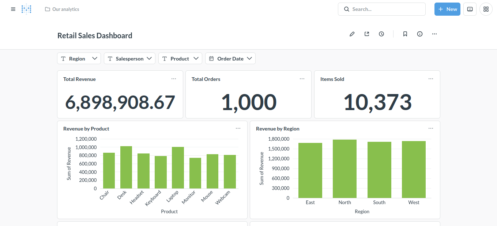
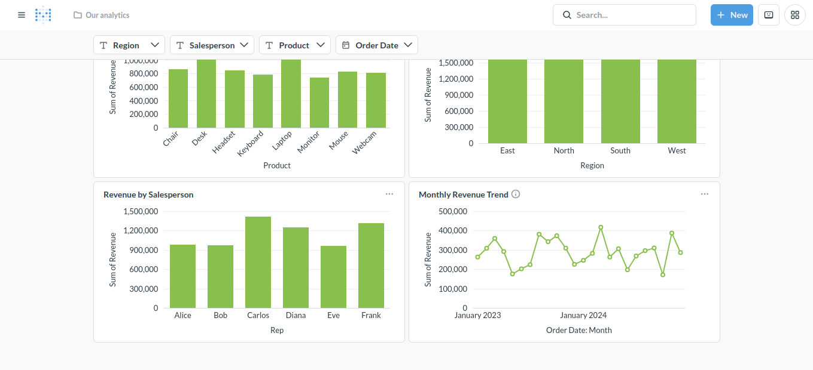

# Retail Sales Analytics

End-to-end retail sales analytics project using PostgreSQL, dbt, SQL, and Metabase.

## Dataset

Synthetic retail sales dataset containing 1,000 orders from January 2, 2023 through December 31, 2024.

## Business Results

- Total Revenue: $6,898,908.67
- Total Orders: 1,000
- Items Sold: 10,373
- Top Product: Desk — $1,021,571.12
- Top Salesperson: Carlos — $1,418,990.97
- Top Region: North — $1,779,969.45

## Dashboard

The Metabase dashboard includes:

- Total Revenue
- Total Orders
- Items Sold
- Revenue by Product
- Revenue by Region
- Revenue by Salesperson
- Monthly Revenue Trend

Interactive filters:

- Region
- Salesperson
- Product
- Order Date

### Dashboard — Top

### Dashboard — Bottom

## Business Findings

Desk and Laptop are the strongest products by revenue, each generating approximately $1 million.

Carlos is the strongest salesperson, generating approximately $1.42 million in revenue.

Regional performance is balanced. North leads at about $1.78 million, while all four regions generate between approximately $1.67 million and $1.78 million.

Monthly revenue fluctuates considerably, making product, salesperson, region, and date filters useful for investigating changes in performance.

## Recommended Actions

- Prioritize Desk and Laptop inventory and promotions; together they generate $2.03 million in revenue.
- Use Carlos as a sales benchmark; his $1.42 million exceeds the lowest salesperson by about $459,000.
- Test campaigns in East; North generates about $106,838 more revenue.

## Data Validation

PostgreSQL and dbt checks confirmed 1,000 orders, 10,373 items sold, and $6,898,908.67 in revenue.

## Data Pipeline

Raw sales data → PostgreSQL → dbt models → analytics-ready data → Metabase dashboard → business recommendations

## Technology

- PostgreSQL
- SQL
- dbt
- Metabase
- Git
- GitHub
- Linux

## Client Use Case

This workflow can be adapted for a small business with sales data in Excel, CSV files, or an existing database. The deliverable can include cleaned data, repeatable transformations, business analysis, an interactive dashboard, and a short findings report.

